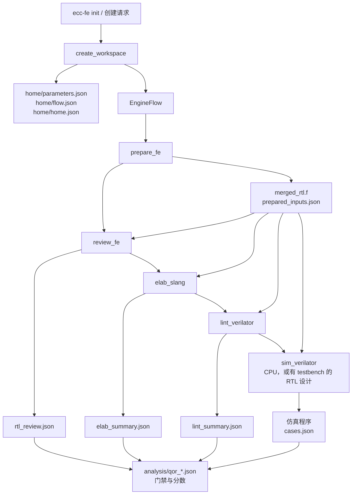
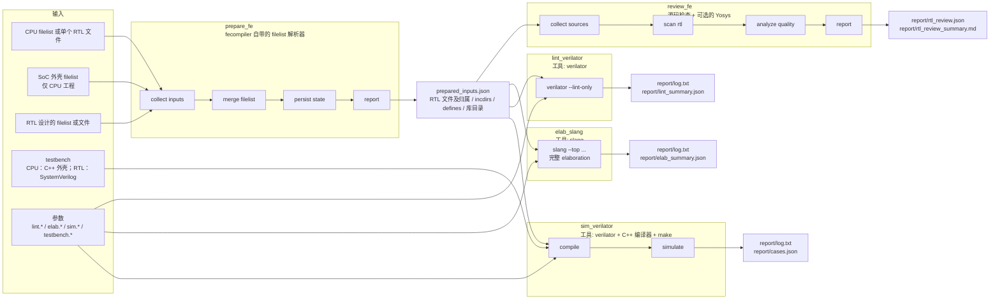
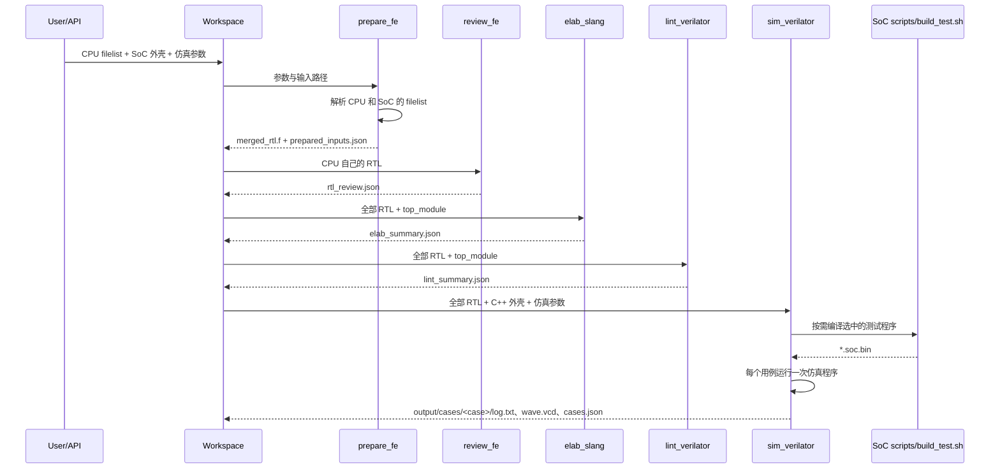

# FE 流程图与依赖

本文档描述 `ecc-fe` 的前端流程：有哪些步骤、每一步用什么工具、读什么、写什么。

流程由设计类型决定（`fecompiler/allflow/profile.py`）：

| 设计类型 | 步骤 |
| --- | --- |
| CPU（`cpu`） | prepare → review → elab → lint → sim（在 SoC 外壳上跑程序） |
| RTL（`rtl`），没有 testbench | prepare → review → elab → lint |
| RTL（`rtl`），工程指定了 testbench | prepare → review → elab → lint → sim（跑这个 testbench） |

步骤本身只在 `fecompiler/allflow/steps.py` 定义一次，见文末的"Step 注册表"。

## 总览图



RTL 源文件不复制进工作区：`parameters.json` 记录的是它们的路径，每次运行读到的都是
当前内容。

## 依赖关系图



## Step 目录结构

每一步由 `fecompiler/tools/fe/builder.py` 生成统一目录：

```text
<workspace>/<step>_<tool>/
├── config/
├── data/
├── output/
│   └── <design>_<step>.json
├── report/
│   └── <step>.rpt          # 该步骤的结果摘要（JSON 内容）
├── log/
│   └── log.txt
├── script/
├── analysis/
│   ├── qor_metrics.json    # 指标
│   ├── qor_summary.json    # 门禁、质量结论、分数
│   └── qor_hotspots.json   # 需要关注的位置
├── subflow.json            # 子步骤状态
└── checklist.json
```

各步骤在 `report/` 下的主要文件：

| 步骤目录 | 文件 |
| --- | --- |
| `prepare_fe` | `prepare.rpt`；另有 `output/merged_rtl.f`、`output/prepared_inputs.json` |
| `review_fe` | `rtl_review.json`、`rtl_review_summary.md` |
| `elab_slang` | `log.txt`、`elab_summary.json` |
| `lint_verilator` | `log.txt`、`lint_summary.json` |
| `sim_verilator` | `log.txt`、`cases.json`，见下 |

CPU 工程的 `sim_verilator`：

```text
sim_verilator/
├── obj_dir/                      # Verilator 的构建目录
├── output/
│   ├── <design>_sim              # 仿真程序
│   ├── <design>_sim.build.json   # 这个程序是用什么构建的
│   └── cases/<case>/
│       ├── <case>.soc.bin
│       ├── log.txt
│       └── wave.vcd
├── report/
│   ├── log.txt
│   ├── build_programs.log.txt
│   ├── cases.json
│   ├── cases/<case>/log.txt
│   ├── history.json
│   └── runs/<run_id>/
└── log/log.txt                   # 仿真程序的编译日志
```

RTL 工程的 `sim_verilator` 只有 `obj_dir/`、`output/<testbench top>_sim`、`report/log.txt`、
`report/cases.json` 和 `log/log.txt`；仿真在 `output/` 目录里运行，testbench 自己写出的
波形文件也在那里。

## 各步骤明细

| 步骤 | 工具 | 主要输入 | 主要输出 | 子步骤 |
|---|---|---|---|---|
| `prepare_fe` | fecompiler 自带的 filelist 解析器 | CPU 工程：`cpu_filelist`（或单个 RTL 文件）和 `soc_filelist`；RTL 工程：`input_filelist` 或 RTL 文件列表 | `output/merged_rtl.f`、`output/prepared_inputs.json`、`report/prepare.rpt` | `collect inputs`、`merge filelist`、`persist state`、`report` |
| `review_fe` | 源码检查（Python）；Yosys 做结构预检查，没装时这部分不评估 | prepare 结果里用户自己的 RTL | `report/rtl_review.json`、`report/rtl_review_summary.md` | `collect sources`、`scan rtl`、`analyze quality`、`report` |
| `elab_slang` | `slang`（Resource Manager、`PATH` 或 `ECOS_SLANG`） | prepare 结果、`top_module`、`design.parameters`、`elab.extra_args` | `report/log.txt`、`report/elab_summary.json` | `elaborate`、`report` |
| `lint_verilator` | `verilator --lint-only`（Resource Manager、`PATH` 或 `ECOS_VERILATOR`） | prepare 结果、`top_module`、`lint.*` 参数（规则集、waiver、baseline） | `report/log.txt`、`report/lint_summary.json` | `lint`、`report` |
| `sim_verilator`（CPU） | `verilator --cc --exe --build`；SoC 的 `scripts/build_test.sh` 编译测试程序；可选 difftest 参考模型 | prepare 结果、C++ 外壳（`testbench`、`sim_cpp_sources`）、`sim_cflags`、`sim_ldflags`、`sim_run_args`、用例选择 | `output/<design>_sim`、`output/cases/<case>/`、`report/cases.json`、`report/runs/<run_id>/` | `compile`、`simulate`、`report` |
| `sim_verilator`（RTL） | `verilator --binary --timing --trace` | prepare 结果、`testbench.top`、`testbench.files` 及其余 `testbench.*` 参数 | `output/<testbench top>_sim`、`report/log.txt`、`report/cases.json`（`kind` 为 `testbench`，一个 case） | `compile`、`simulate`、`report` |

两种仿真的实现分别在 `fecompiler/tools/verilator/runner.py`（CPU）和
`fecompiler/tools/verilator/testbench.py`（RTL），`fecompiler/tools/verilator/sim.py`
按设计选择其中一个。

工具约定上的差别：lint 和 elab 定义宏 `SYNTHESIS`，仿真不定义；所以 `` `ifdef SYNTHESIS ``
里的代码，被检查的和被仿真的不是同一份。

## 数据如何流动

1. `ecc-fe init` 创建工作区（工程模式下是 `.ecc-fe/template`，每个 run 从它复制而来）。
2. `home/parameters.json` 保存参数和 RTL 的路径，`home/flow.json` 保存每一步的状态。
3. `prepare_fe` 解析 filelist（格式见下一节），写出 `prepared_inputs.json`：RTL 文件及其
   归属（用户的、SoC 外壳的、第三方的）、include 目录、宏定义、库目录。
4. 之后的步骤都从 `prepared_inputs.json` 读取输入。输入变了，prepare 会先自动重跑。
5. 每一步结束后，`analysis/` 下生成门禁、质量结论和分数
   （规则见 `docs/specification/quality-scoring.md`）。
6. 每一步的结果带有签名：执行代码、参数、输入内容、工具任何一项变了，结果就标为过期，
   `ecc-fe run --resume` 会重跑它。
7. CPU 的 `sim_verilator` 先编译仿真程序，再按用例运行：
   - 显式镜像：`sim_images`。
   - 扫描镜像：`sim_all_tests` + `sim_tests_dir`。
   - 先编译程序再运行：`sim_build_all_programs`、`sim_program_names`、
     `sim_program_sources`、`sim_programs_dir`。

   仿真程序带有一份构建记录（`<design>_sim.build.json`：构建命令，以及构建时读过的
   每个文件的哈希，包括被 include 的头文件）：

   - 构建命令和上次相同时，在原有的 `obj_dir` 上增量构建，只重编变了的部分；命令变了
     （编译参数、源文件列表、top）就从空目录重新构建。并行数（`sim.build_jobs`）不算
     构建命令的一部分。
   - 要求复用已有程序时（`sim_reuse_binary`，只能由直接调用引擎的代码设置），只有记录
     与当前输入完全一致才复用，否则重新构建，并在编译日志的第一行说明原因。

   测试程序也各带一份构建记录（`<程序名>.soc.bin.build.json`）：程序自己的源文件、
   SoC 的 `tests/common`、`tests/include`、`tests/benchmarks` 下的全部文件、构建脚本、
   脚本从环境里读的设置、它会选中的编译器，以及生成的镜像。全部没变的程序不再重编，
   构建日志里记为 `up to date`。构建脚本不在 SoC 的标准目录结构里时无法知道它读了
   什么，这种情况每次都重编。

   `run --clean` 让这两种记录都不被采信：`obj_dir` 清空后重新构建，所有测试程序重编
   （`fecompiler/tools/common/build_policy.py`）。

   需要编译的测试程序各自独立编译，`sim.build_jobs` 个同时进行；用例默认一个一个跑，
   `sim.case_jobs` 可以让多个用例同时跑。`report/runs/` 只保留最近
   `sim.history_limit` 次运行。

## CPU 工程的仿真链路



## filelist 格式

所有读取 filelist 的地方（prepare、review、目录校验、源码指纹、工作区创建）都使用
`fecompiler/tools/common/filelist.py` 这一个解析器，规则只有一份：

| 写法 | 含义 |
| --- | --- |
| `a.v b.sv` | 一行可以写多个文件；后缀不分大小写（`.V`、`.SV` 也认） |
| `-f X`、`-F X`、`-fX`、`-FX` | 嵌套 filelist，相对路径以写出它的那个 filelist 所在目录为基准 |
| `+incdir+a+b`、`-I a`、`-Ia`、`-incdir a` | include 目录 |
| `+define+A+B=1`、`-D A`、`-DA=1` | 宏定义 |
| `-v lib.v` | 库文件，当作普通 RTL 文件读入 |
| `x.vh`、`x.svh` | 头文件：不单独编译，它所在的目录会自动加入 include 目录 |
| `$VAR`、`${VAR}`、`$(VAR)` | 环境变量，出现在任何路径里都会展开 |
| `#`、`//` 开头，或行内 `#`、`//` 之后 | 注释 |

不会有东西被静默丢掉：

- 文件不存在，或路径里用了未定义的环境变量：prepare 失败，错误里写明是哪一项。
- include 目录不存在：仍然传给工具，同时记到 `prepare.rpt` 的 `input_notes`
  （`kind=missing_incdir`）。
- `-y dir` 和 `+libext+.v+.sv`：库目录和库文件后缀，会传给 review、elab、lint 和
  仿真编译。
- 解析器不处理的条目（其他后缀的文件、工具自己的选项）：记到 `input_notes`
  （`kind=unsupported_entry`）。这些不会传给任何工具；工具参数请用 `lint.extra_args`、
  `elab.extra_args`。

### top 模块的识别

prepare 要求 top 模块恰好定义一次。识别时：

- 认 `module top`、`macromodule top`、`module automatic top`、`module static top`。
- 注释先去掉；`// see /*` 是行注释，不会吞掉后面的代码；字符串里的 `//` 不算注释。
- 先按 filelist 里的宏定义选择 `` `ifdef `` 分支，所以"每个分支各写一次 top"算一次定义。
  如果这样一个也选不出来（宏可能来自被 include 的头文件，解析器不跟进 include），
  退回到不看分支的统计。

CPU 模式下的端口契约检查同样带上 filelist 里的宏定义。端口位宽里的参数按模块
参数的默认值求值（支持 `+ - * / % **`、括号和 `$clog2`）；求不出来的位宽不判为
不匹配，留给 elab 检查。

## review 的判断规则

review 只看用户自己的 RTL（CPU 工程的 CPU 部分，RTL 工程的整个设计），源文件、include
目录、库目录和宏定义都取自 prepare 的结果；只有 prepare 结果不是最新时才自己读 filelist。

源码启发式检查先去掉注释再逐行看，所以注释掉的代码不会被报告。它们给出的都是
`warning` 或 `info`，不会是 `error`：

| 检查 | 不再误报的情况 |
| --- | --- |
| 由逻辑生成的时钟 | `assign clk_o = clk_i;` 这类改名；`clk_en`、`clk_sel`、`clk_cnt`、`*_valid` 等不是时钟的名字 |
| 条件里用了时钟 | 只是名字里含 `clk` 字样的信号或参数（如 `MUL_CLKGATE`） |
| 异步复位 | 每个文件只给一条 `info`，带上出现的块数，不再每个 `always` 一条警告 |
| 组合逻辑 `if` 缺 `else` | 认 `always @*`、`always @(*)`、`always_comb`；块开头已赋默认值的不报；不会读到下一个块里去 |
| `case` 缺 `default` | `unique` / `priority case` 不报；只看到自己的 `endcase` 为止 |
| 一行里运算符过多 | 行尾注释里的 `/`、`-` 不计入 |

### 问题指纹和 waiver

每个问题有一个指纹，`review_waivers` 按指纹豁免。指纹由"检查项 + 文件（相对 filelist
所在目录）+ 该行代码本身 + 同样的行里第几次出现"组成，不含行号和绝对路径，所以：

- 在问题上方增删代码，指纹不变，waiver 继续生效；
- 换一个目录检出同一份代码，指纹不变；
- 改了那一行代码本身，指纹才变。

用旧指纹（含行号）写的 waiver 仍然被接受，直到那一行的行号变动为止。

### Yosys 结构预检查不再拦住合法设计

- 没有 yosys-slang 插件时，Yosys 只能用自带的解析器读 SystemVerilog，它拒绝的写法可能
  完全合法。这种情况下预检查的错误记为工具限制，review 不会失败，由 elab 把关。
- 源文件或 include 路径里有空格时（Yosys 脚本表达不了），预检查跳过并说明原因，
  结构指标不可用，其余检查照常。

## Step 注册表

每个步骤在 `fecompiler/allflow/steps.py` 里有且只有一条 `StepDefinition`，记录：

| 字段 | 含义 |
|---|---|
| `name` / `tool` | 步骤名与工具名，目录名固定为 `<name>_<tool>` |
| `handler` | 执行该步骤的 `BaseStep` 子类（`模块:类名`，运行时才导入） |
| `qor_report` | QoR 分析读取的 `report/` 下的文件 |
| `config_fields` / `config_prefixes` | 变化后会让成功结果失效的 workspace 参数 |
| `config_files` | 值是文件路径的参数：文件内容变了，结果同样失效（lint 的 waiver 和 baseline、testbench 文件） |
| `source_files` / `executables` | 计入溯源指纹的 runner 源码与外部工具 |
| `doctor_checks` | `ecc-fe doctor --step <name>` 检查的环境项 |

流程 profile、引擎、溯源、CLI 的步骤校验和目录定位都从注册表读取，不再各自维护
步骤名表。应用层里和具体步骤相关的逻辑也各自成表，而不是散落的 `if step == ...`：

| 表 | 位置 | 内容 |
|---|---|---|
| `_STEP_DETAILS` | `application/step_detail.py` | 每个步骤往详情和摘要里添加的字段 |
| `_STEP_ARTIFACTS` | `application/step_detail.py` | 步骤额外列出的产物文件 |
| `_STEP_RUN_SETUP` | `application/sim_config.py` | 步骤运行前要做的配置（目前只有 sim 选择测试集） |

注册表里 `prepares_inputs` 标出产生"已准备输入"的那一步（prepare），其余步骤在输入
过期时会先自动重跑它。
新增一个步骤需要：在注册表加一条定义，在 `allflow/profile.py` 把它列入
相应 profile，在 `analysis/qor.py` 提供对应的 QoR 构建函数，并把它的处理模块写进
`ecc-fe.spec` 的 `HIDDENIMPORTS`（处理模块按名字导入，打包时不会被自动发现；
`test/test_packaging_handlers.py` 会检查这一点）。

## 关键代码位置

| 功能 | 文件 |
|---|---|
| Step 注册表（步骤的唯一定义处） | `fecompiler/allflow/steps.py` |
| 各设计类型运行哪些步骤 | `fecompiler/allflow/profile.py` |
| Workspace 创建/读取 | `fecompiler/data/workspace.py` |
| 应用层操作（create/load/run-flow/run-step 等，CLI 与 RPC 共用） | `fecompiler/application/workspace_service.py` |
| 创建请求的规范化与校验 | `fecompiler/application/create_request.py` |
| 仿真配置（SoC 运行参数、测试集、CoreMark、difftest） | `fecompiler/application/sim_config.py` |
| 各步骤的详情、报告与失败信息 | `fecompiler/application/step_detail.py` |
| 应用层结果类型与进度事件 | `fecompiler/application/result.py`、`events.py` |
| Flow 编排与状态维护 | `fecompiler/engine/flow.py` |
| Step 目录结构 | `fecompiler/tools/fe/builder.py` |
| Prepare 实现 | `fecompiler/tools/prepare/runner.py` |
| Slang elaboration | `fecompiler/tools/slang/runner.py` |
| Verilator lint（设置、诊断解析、baseline 门禁） | `fecompiler/tools/verilator/lint.py` |
| sim 步骤的入口（按设计选择下面两种之一） | `fecompiler/tools/verilator/sim.py` |
| CPU 仿真（SoC 外壳、测试程序、用例、回归记录） | `fecompiler/tools/verilator/runner.py` |
| 仿真程序的构建记录与复用判断 | `fecompiler/tools/verilator/build_stamp.py` |
| 测试程序的构建记录（没变就不重编） | `fecompiler/tools/verilator/program_build.py` |
| 覆盖率数据的合并与汇总（`sim.coverage` / `testbench.coverage`） | `fecompiler/tools/verilator/coverage.py` |
| RTL 设计用自己的 testbench 仿真 | `fecompiler/tools/verilator/testbench.py` |
| review（步骤入口、源码检查、Yosys 结构预检查） | `fecompiler/tools/review/runner.py`、`analyzer.py`、`structural_probe.py` |
| 门禁、质量结论、分数 | `fecompiler/analysis/qor.py`、`scoring.py`、`scoring_policy.json` |
| 结果签名与过期判断 | `fecompiler/engine/provenance.py` |
| 交接清单 | `fecompiler/cli/handlers/handoff.py` |
| 各工具的设置读取 | `fecompiler/tools/common/tool_config.py` |
| RTL 输入共享解析 | `fecompiler/tools/common/rtl_inputs.py` |
| filelist 解析（`-f/-F`、`+incdir+`、`+define+`、缺失文件报告） | `fecompiler/tools/common/filelist.py` |
