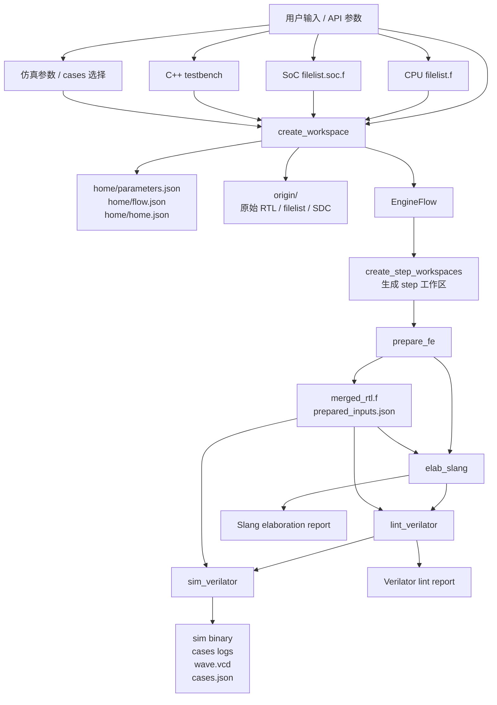
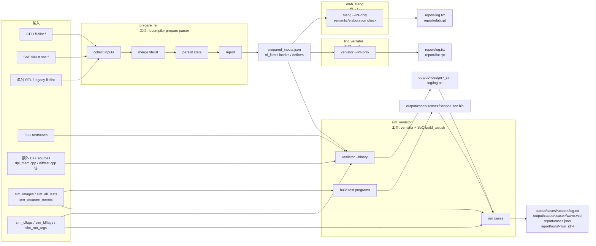
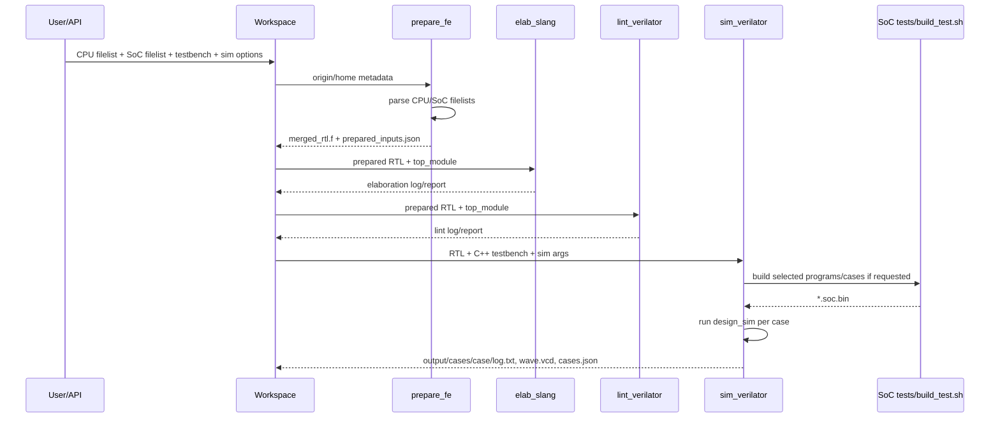

# FE 流程图与依赖

本文档描述 `ecc-fe` 当前默认前端流程，以及每一步依赖的工具、输入和输出。

默认步骤来自 `fecompiler/allflow/builder.py`：

```text
prepare -> elab -> lint -> sim
```

## 总览图



## 依赖关系图



## Step 目录结构

每一步由 `fecompiler/tools/fe/builder.py` 生成统一目录：

```text
<workspace>/<step>_<tool>/
├── config/
├── data/
├── output/
│   └── <design>_<step>.json
├── report/
│   └── <step>.rpt
├── log/
│   └── log.txt
├── script/
├── analysis/
├── subflow.json
└── checklist.json
```

`sim_verilator` 会额外产生：

```text
sim_verilator/
├── output/
│   ├── <design>_sim
│   └── cases/
│       └── <case>/
│           ├── <case>.soc.bin
│           ├── log.txt
│           └── wave.vcd
├── report/
│   ├── log.txt
│   ├── build_programs.log.txt
│   ├── cases.json
│   ├── cases/<case>/log.txt
│   └── runs/<run_id>/
└── log/log.txt
```

## 各步骤明细

| Step | Tool | 主要输入 | 主要输出 | 子步骤 |
|---|---|---|---|---|
| `prepare_fe` | Python parser | `cpu_filelist`, `soc_filelist`; 或 legacy `input_filelist`; 或 `origin_verilog` | `output/merged_rtl.f`, `output/prepared_inputs.json`, `report/prepare.rpt` | `collect inputs`, `merge filelist`, `persist state`, `report` |
| `elab_slang` | Resource Manager/PATH 中的 `slang`，或 `ECOS_SLANG` | `prepared_inputs.json` 中的 RTL / incdirs / defines, `top_module` | `report/log.txt`, `report/elab.rpt` | `elaborate`, `report` |
| `lint_verilator` | Resource Manager/PATH 中的 `verilator`，或 `ECOS_VERILATOR` | `prepared_inputs.json` 中的 RTL / incdirs / defines, `top_module` | `report/log.txt`, `report/lint.rpt` | `lint`, `report` |
| `sim_verilator` | `verilator --binary`; 可选 SoC `scripts/build_test.sh`; 可选 difftest ref so | RTL, `testbench`, `sim_cpp_sources`, `sim_cflags`, `sim_ldflags`, `sim_run_args`, cases 配置 | `output/<design>_sim`, `output/cases/<case>/`, `report/cases.json`, `report/runs/<run_id>/` | `compile`, `simulate`, `report` |

## 数据如何流动

1. 用户创建 workspace 时传入 CPU、SoC、testbench、仿真参数等。
2. `home/parameters.json` 持久化这些参数，`home/flow.json` 保存全流程状态。
3. `prepare_fe` 解析 filelist：
   - 支持 `-f` / `-F` 嵌套 filelist。
   - 收集 `.v` / `.sv`。
   - 收集 `+incdir+...` 和 `+define+...`。
   - 写出标准化 `prepared_inputs.json`。
4. `elab_slang`、`lint_verilator`、`sim_verilator` 优先从 `prepared_inputs.json` 读取 RTL 输入。
5. `sim_verilator` 先编译仿真器，再按 cases 运行：
   - 显式镜像：`sim_images`。
   - 扫描镜像：`sim_all_tests + sim_tests_dir`。
   - 先编译程序再运行：`sim_build_all_programs`, `sim_program_names`, `sim_program_sources`, `sim_programs_dir`。

## 常见 SoC + CPU 仿真链路



## filelist 格式

所有读取 filelist 的地方（prepare、review、目录校验、源码指纹、工作区创建）都使用
`fecompiler/tools/common/filelist.py` 这一个解析器，规则只有一份：

| 写法 | 含义 |
| --- | --- |
| `a.v b.sv` | 一行可以写多个文件；后缀不分大小写（`.V`、`.SV` 也认） |
| `-f X`、`-F X`、`-fX`、`-FX` | 嵌套 filelist，相对路径以写出它的那个 filelist 所在目录为基准 |
| `+incdir+a+b`、`-I a`、`-Ia`、`-incdir a` | include 目录 |
| `+define+A+B=1`、`-D A`、`-DA=1` | 宏定义 |
| `-v lib.v` | 库文件，当作普通 RTL 文件读入 |
| `x.vh`、`x.svh` | 头文件：不单独编译，它所在的目录会自动加入 include 目录 |
| `$VAR`、`${VAR}`、`$(VAR)` | 环境变量，出现在任何路径里都会展开 |
| `#`、`//` 开头，或行内 `#`、`//` 之后 | 注释 |

不会有东西被静默丢掉：

- 文件不存在，或路径里用了未定义的环境变量：prepare 失败，错误里写明是哪一项。
- include 目录不存在：仍然传给工具，同时记到 `prepare.rpt` 的 `input_notes`
  （`kind=missing_incdir`）。
- 解析器不处理的条目（`-y dir`、`+libext+`、其他后缀的文件、工具自己的选项）：
  记到 `input_notes`（`kind=unsupported_entry`）。这些目前不会传给任何工具。

### top 模块的识别

prepare 要求 top 模块恰好定义一次。识别时：

- 认 `module top`、`macromodule top`、`module automatic top`、`module static top`。
- 注释先去掉；`// see /*` 是行注释，不会吞掉后面的代码；字符串里的 `//` 不算注释。
- 先按 filelist 里的宏定义选择 `` `ifdef `` 分支，所以"每个分支各写一次 top"算一次定义。
  如果这样一个也选不出来（宏可能来自被 include 的头文件，解析器不跟进 include），
  退回到不看分支的统计。

CPU 模式下的端口契约检查同样带上 filelist 里的宏定义。端口位宽里的参数按模块
参数的默认值求值（支持 `+ - * / % **`、括号和 `$clog2`）；求不出来的位宽不判为
不匹配，留给 elab 检查。

## Step 注册表

每个步骤在 `fecompiler/allflow/steps.py` 里有且只有一条 `StepDefinition`，记录：

| 字段 | 含义 |
|---|---|
| `name` / `tool` | 步骤名与工具名，目录名固定为 `<name>_<tool>` |
| `handler` | 执行该步骤的 `BaseStep` 子类（`模块:类名`，运行时才导入） |
| `qor_report` | QoR 分析读取的 `report/` 下的文件 |
| `config_fields` / `config_prefixes` | 变化后会让成功结果失效的 workspace 参数 |
| `source_files` / `executables` | 计入溯源指纹的 runner 源码与外部工具 |
| `doctor_checks` | `ecc-fe doctor --step <name>` 检查的环境项 |

流程 profile、引擎、溯源、CLI 的步骤校验和目录定位都从注册表读取，不再各自维护
步骤名表。应用层里和具体步骤相关的逻辑也各自成表，而不是散落的 `if step == ...`：

| 表 | 位置 | 内容 |
|---|---|---|
| `_STEP_DETAILS` | `application/step_detail.py` | 每个步骤往详情和摘要里添加的字段 |
| `_STEP_ARTIFACTS` | `application/step_detail.py` | 步骤额外列出的产物文件 |
| `_STEP_RUN_SETUP` | `application/sim_config.py` | 步骤运行前要做的配置（目前只有 sim 选择测试集） |

注册表里 `prepares_inputs` 标出产生"已准备输入"的那一步（prepare），其余步骤在输入
过期时会先自动重跑它。
新增一个步骤需要：在注册表加一条定义，在 `allflow/profile.py` 把它列入
相应 profile，并在 `analysis/qor.py` 提供对应的 QoR 构建函数。

## 关键代码位置

| 功能 | 文件 |
|---|---|
| Step 注册表（步骤的唯一定义处） | `fecompiler/allflow/steps.py` |
| 各设计类型运行哪些步骤 | `fecompiler/allflow/profile.py` |
| Workspace 创建/读取 | `fecompiler/data/workspace.py` |
| 应用层操作（create/load/run-flow/run-step 等，CLI 与 RPC 共用） | `fecompiler/application/workspace_service.py` |
| 创建请求的规范化与校验 | `fecompiler/application/create_request.py` |
| 仿真配置（SoC 运行参数、测试集、CoreMark、difftest） | `fecompiler/application/sim_config.py` |
| 各步骤的详情、报告与失败信息 | `fecompiler/application/step_detail.py` |
| 应用层结果类型与进度事件 | `fecompiler/application/result.py`、`events.py` |
| Flow 编排与状态维护 | `fecompiler/engine/flow.py` |
| Step 目录结构 | `fecompiler/tools/fe/builder.py` |
| Prepare 实现 | `fecompiler/tools/prepare/runner.py` |
| Slang elaboration | `fecompiler/tools/slang/runner.py` |
| Verilator lint/sim | `fecompiler/tools/verilator/runner.py` |
| RTL 输入共享解析 | `fecompiler/tools/common/rtl_inputs.py` |
| filelist 解析（`-f/-F`、`+incdir+`、`+define+`、缺失文件报告） | `fecompiler/tools/common/filelist.py` |
